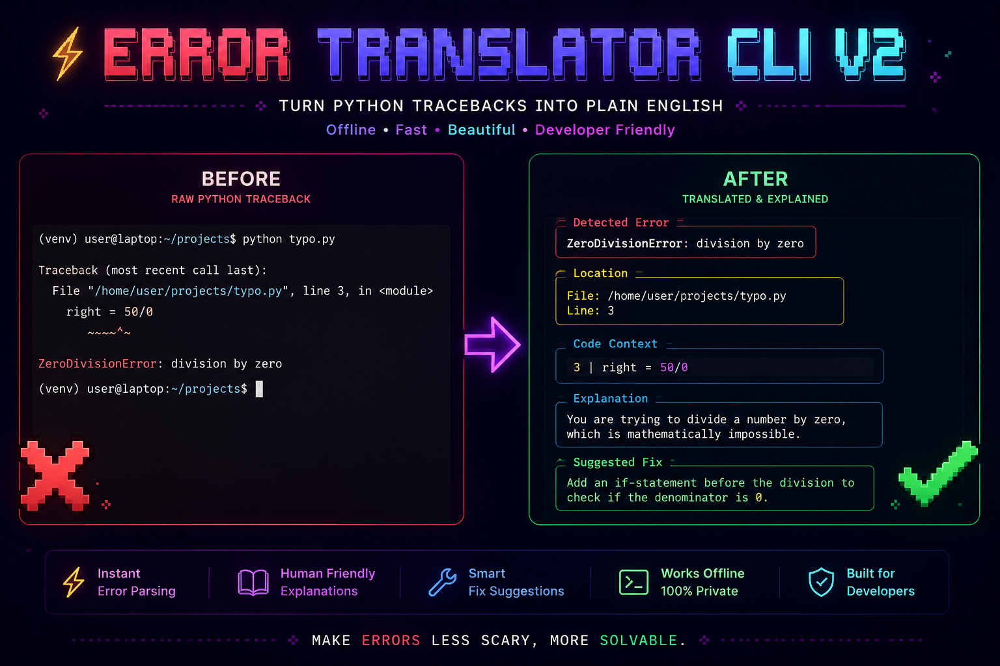
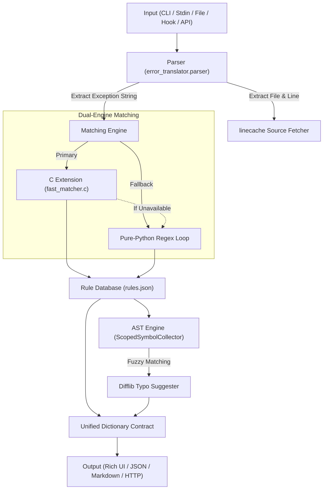

# Error Translator CLI v2

<div align="center">
  

  # Error Translator CLI v2

  **Deterministic Python Traceback Analysis and Exception Diagnostics**

  [](https://pypi.org/project/error-translator-cli-v2/)
  [](https://pypi.org/project/error-translator-cli-v2/)
  [](https://github.com/gourabanandad/error-translator-cli-v2/actions)
  [](LICENSE)
  [](https://github.com/astral-sh/ruff)
  [](#why-error-translator)

  [Overview](#overview) • [Features](#features) • [Installation](#installation) • [Quickstart](#quickstart) • [Integration Surfaces](#integration-surfaces) • [Architecture](#architecture) • [Documentation](#documentation)

</div>

---

## Overview

**Error Translator** is a local-first, deterministic Python traceback analyzer and exception diagnostics engine. It intercepts Python error strings, inspects source files via `linecache`, performs scoped Abstract Syntax Tree (AST) lexical analysis for typo detection, and produces structured diagnostic panels with actionable remediation advice.

Standard Python tracebacks identify where an error occurred, but often leave developers to decipher cryptic messages. Cloud AI assistants can provide explanations, but introduce latency, cost, and data privacy concerns. Error Translator bridges this gap by running entirely on the local machine with sub-millisecond execution times and zero network egress.

> [!NOTE]
> Error Translator operates 100% offline. Source code, file paths, and runtime errors are processed locally using deterministic regex rules and local AST traversal. No data is transmitted over the network.

### Diagnostic Comparison

```text
RAW TRACEBACK:
Traceback (most recent call last):
  File "app.py", line 14, in <module>
    total = "Users: " + user_cnt
NameError: name 'user_cnt' is not defined. Did you mean: 'user_count'?

ERROR TRANSLATOR DIAGNOSTIC PANEL:
┌─ Detected Error ─────────────────────────────────────────────────────────────┐
│ NameError: name 'user_cnt' is not defined                                    │
├─ Location ───────────────────────────────────────────────────────────────────┤
│ File: app.py  |  Line: 14                                                    │
├─ Code Context ───────────────────────────────────────────────────────────────┤
│ 14 │ total = "Users: " + user_cnt                                            │
├─ Explanation ────────────────────────────────────────────────────────────────┤
│ You tried to use a variable or function named 'user_cnt', but Python doesn't │
│ recognize it in the current scope.                                           │
├─ Suggested Fix ──────────────────────────────────────────────────────────────┤
│ Check if 'user_cnt' is spelled correctly, or define/import it first.         │
├─ AST Insight ────────────────────────────────────────────────────────────────┤
│ Did you mean 'user_count'? There appears to be a typo.                       │
└──────────────────────────────────────────────────────────────────────────────┘
```

---

## Features

- **Deterministic Rule Engine**: Over 56 rule patterns covering 26 standard Python exception classes with actionable explanations and fixes.
- **Dual Matching Engine**: Uses an optional compiled C extension (`fast_matcher.c`) for high-throughput regex matching, with transparent fallback to pure Python for universal compatibility.
- **Lexical-Scope AST Analysis**: Inspects Abstract Syntax Tree boundaries (`lineno` and `end_lineno`) using `ScopedSymbolCollector` to detect typos and suggest identifiers strictly within the relevant function or class scope.
- **Multi-Surface Integration**: Operates via terminal CLI, interactive REPL, automatic `sys.excepthook` interceptor, programmatic Python API, Jupyter notebook extension, and FastAPI REST microservice.
- **Flexible Output Formats**: Renders styled Rich terminal panels for interactive debugging, clean Markdown for notebooks, and single-line JSON for automated CI/CD pipelines.
- **Privacy and Determinism**: Zero network calls, zero telemetry, and consistent, reproducible diagnostic output across environments.

---

## Why Error Translator

| Capability | Error Translator | Standard Python Traceback | Cloud LLM Assistants |
| :--- | :---: | :---: | :---: |
| **Privacy & Security** | **100% Offline (Zero egress)** | Local | Source code sent over network |
| **Translation Latency** | **Sub-millisecond (< 1 ms)** | Instant | 1,000 – 4,000 ms |
| **Execution Cost** | **Free ($0.00)** | Free | Token / subscription fees |
| **Remediation Advice** | **Actionable fixes provided** | Exception line only | Variable quality |
| **AST Typo Suggestions** | **Lexical-scope aware** | Global / Python 3.10+ basic | Prone to hallucination |
| **Integration Surfaces** | **CLI, REPL, Hook, API, Jupyter, REST** | Terminal only | Chat interface / Web |
| **CI/CD Automation** | **JSON output mode (`--json`)** | Raw text scraping | Complex API orchestration |

---

## Installation

Error Translator requires **Python 3.9** or newer.

```bash
# Standard installation (CLI, Python API, and Auto Hook)
pip install error-translator-cli-v2

# With Jupyter / IPython extension
pip install "error-translator-cli-v2[jupyter]"

# With FastAPI REST server and Web dashboard
pip install "error-translator-cli-v2[server]"

# Full installation (all optional dependencies)
pip install "error-translator-cli-v2[server,jupyter]"
```

Using `uv`:

```bash
# Add to an existing project
uv add error-translator-cli-v2

# Run directly without installation
uvx --from error-translator-cli-v2 explain-error --help
```

Verify the installation:

```bash
explain-error --version
```

---

## Quickstart

### 1. Execute a Target Python Script

Run a Python script through `explain-error`. If the script executes successfully, standard output passes through untouched. If an unhandled exception occurs, standard error is intercepted and translated:

```bash
explain-error run script.py
```

Shorthand syntax (direct `.py` path):

```bash
explain-error script.py
```

### 2. Translate Raw Error Strings

Pass exception strings directly as CLI arguments:

```bash
explain-error "TypeError: can only concatenate str (not 'int') to str"
```

### 3. Pipe Logs from Stdin

Stream log files, test outputs, or container logs directly into the CLI:

```bash
# Pipe from a file
cat crash.log | explain-error

# Pipe from Docker container logs
docker logs backend-container 2>&1 | explain-error
```

### 4. Direct Log File Translation

Pass a log file directly to parse the recorded traceback:

```bash
explain-error server_error.log
```

### 5. Interactive REPL Mode

Launch an interactive debugging session to paste single-line or multi-line tracebacks without restarting the tool:

```bash
explain-error interactive
```

### 6. Machine-Readable JSON Mode

Append `--json` to any command to receive single-line JSON, ideal for piping into `jq` or feeding CI/CD alert bots:

```bash
explain-error --json "KeyError: 'auth_token'"
```

Example JSON structure:

```json
{
  "explanation": "You tried to look up a key named 'auth_token' in a dictionary, but that key doesn't exist.",
  "fix": "Check for typos in the key name, or use the .get('auth_token') method to safely access dictionary values.",
  "ast_insight": null,
  "matched_error": "KeyError: 'auth_token'",
  "file": "Unknown File",
  "line": "Unknown Line",
  "code": ""
}
```

```bash
# Extract the actionable fix using jq
explain-error --json "KeyError: 'auth_token'" | jq -r .fix
```

---

## CLI Reference

```text
Usage: explain-error [OPTIONS] [COMMAND / ARGS]...

Commands & Arguments:
  run <script.py>       Execute a target script and translate tracebacks upon failure.
  interactive           Launch an interactive REPL for one-off and multi-line pastes.
  <path.py>             Direct shorthand to execute a target Python file.
  <path.log>            Read a saved log file and translate the recorded exception.
  "<traceback text>"    Translate raw exception string arguments directly.
  stdin (pipe)          Stream logs via stdin (e.g., cat crash.log | explain-error).

Options:
  --json                Output single-line JSON instead of Rich UI panels.
  --no-color            Disable ANSI color formatting (useful for plain-text logs and CI).
  -a, --about           Display environment information and C-extension build status.
  -v, --version         Show package version, Python runtime, and acceleration status.
  -h, --help            Show the command palette and usage summary.
```

---

## Integration Surfaces

### Automatic Exception Hook (`error_translator.auto`)

Intercept unhandled exceptions globally and render diagnostic cards before process exit without modifying application logic:

```python
# Add this at the top of your application entrypoint (e.g., main.py)
import error_translator.auto


def calculate_ratio(items: list[int]) -> float:
    return sum(items) / len(items)


calculate_ratio([])  # Triggers ZeroDivisionError
```

### Programmatic Python API

Integrate traceback translation into custom logging pipelines, test harnesses, or error reporting workers:

```python
from error_translator import translate_error

traceback_data = """
Traceback (most recent call last):
  File "service.py", line 42, in process_item
    item_id = record["id"]
KeyError: 'id'
"""

result = translate_error(traceback_data)

print(result["matched_error"])  # KeyError: 'id'
print(result["explanation"])  # Plain-English cause
print(result["fix"])  # Actionable remediation
print(result["file"])  # service.py
print(result["line"])  # 42
```

#### API Return Schema Contract

| Field | Type | Description |
| :--- | :--- | :--- |
| `explanation` | `str` | Plain-English summary of why the exception occurred. |
| `fix` | `str` | Actionable remediation advice and code suggestions. |
| `matched_error` | `str` | The exact exception line extracted from the traceback. |
| `file` | `str` | Path to the source file where the error occurred (`Unknown File` if unavailable). |
| `line` | `str` | Line number where the crash originated (`Unknown Line` if unavailable). |
| `code` | `str` | Source line read via `linecache` (empty string if unavailable). |
| `ast_insight` | `str \| None` | Lexical AST typo suggestion (e.g., `"Did you mean 'target'?"`) or `None`. |

### Jupyter / IPython Notebook Extension

Enable in-cell crash diagnostics across Jupyter Notebooks, JupyterLab, Google Colab, and VS Code Notebooks:

```python
# Load the extension in any notebook cell
%load_ext error_translator.jupyter

# Subsequent errors display an inline diagnostic panel
users = {"admin": "root"}
print(users["guest"])
```

> [!TIP]
> The Jupyter extension formats diagnostic panels in clean Markdown, displaying the cause, recommended fix, and any AST typo suggestions directly beneath the standard notebook traceback.

### FastAPI REST Service & Web Dashboard

Run the bundled FastAPI microservice to provide translation capabilities across local networks, containers, or web frontends:

```bash
uvicorn error_translator.api.server:app --host 127.0.0.1 --port 8000
```

- **Web Dashboard**: Access the interactive UI at `http://127.0.0.1:8000/`.
- **Single Translation (`POST /translate`)**:
  ```bash
  curl -X POST http://127.0.0.1:8000/translate \
    -H "Content-Type: application/json" \
    -d '{"traceback_setting": "IndexError: list index out of range"}'
  ```
- **Batch Translation (`POST /translate/batch`)**:
  ```bash
  curl -X POST http://127.0.0.1:8000/translate/batch \
    -H "Content-Type: application/json" \
    -d '{"tracebacks": ["KeyError: \"user\"", "ZeroDivisionError: division by zero"]}'
  ```
- **Health Check (`GET /health`)**:
  ```bash
  curl http://127.0.0.1:8000/health
  ```

---

## Architecture

The translation pipeline follows a deterministic four-stage workflow:



1. **Parser & Source Extraction**: Isolates the crashing file, line number, and error string. Fetches the offending source line via Python's built-in `linecache` module.
2. **Dual-Engine Pattern Matching**: Matches the exception string against pre-compiled regex templates in `rules.json`. Uses native C matching (`fast_matcher.c`) when available, transparently falling back to pure Python `re.search`.
3. **Lexical-Scope AST Analysis**: If the exception is a `NameError`, `AttributeError`, or `ImportError`, parses the source AST. The `ScopedSymbolCollector` respects function and class line ranges (`lineno` to `end_lineno`), comparing symbols with `difflib` without cross-scope leakage.
4. **Unified Output Formatting**: Emits a standardized dictionary payload rendered as a Rich panel in the terminal, Markdown in Jupyter, JSON via CLI/API, or HTML in the web dashboard.

---

## Supported Exception Coverage

Error Translator includes 56+ rule patterns across 26 standard Python exception classes:

| Category | Exception Classes | Common Error Patterns |
| :--- | :--- | :--- |
| **Lookup & Scoping** | `NameError`, `UnboundLocalError`, `AttributeError` | `name 'x' is not defined`, `local variable referenced before assignment`, `object has no attribute` |
| **Types & Values** | `TypeError`, `ValueError` | `can only concatenate str to str`, `unsupported operand type(s)`, `invalid literal for int()` |
| **Collections** | `IndexError`, `KeyError`, `StopIteration` | `list index out of range`, `key not found in dict`, `StopIteration in iterator` |
| **Imports & Modules** | `ModuleNotFoundError`, `ImportError` | `No module named 'pkg'`, `cannot import name 'fn' from 'mod'` |
| **Filesystem & OS** | `FileNotFoundError`, `PermissionError`, `IsADirectoryError`, `FileExistsError`, `OSError` | `[Errno 2] No such file or directory`, `[Errno 13] Permission denied`, `File exists` |
| **Syntax & Indentation** | `SyntaxError`, `IndentationError`, `TabError` | `invalid syntax`, `unexpected EOF while parsing`, `expected an indented block` |
| **Arithmetic** | `ZeroDivisionError`, `OverflowError`, `FloatingPointError` | `division by zero`, `math range error`, `overflow during calculation` |
| **Runtime & Limits** | `RecursionError`, `MemoryError`, `TimeoutError`, `NotImplementedError`, `AssertionError` | `maximum recursion depth exceeded`, `out of memory limit`, `assert statement failed` |

---

## Documentation

Full documentation is available at [https://gourabanandad.github.io/error-translator-cli-v2/](https://gourabanandad.github.io/error-translator-cli-v2/).

- [Features & Integrations Guide](docs/features.md) — Comprehensive guide covering CLI commands, REPL workflows, Jupyter notebook extensions, and FastAPI endpoints.
- [Architecture & Internals](docs/ARCHITECTURE.md) — Technical details on the regex engine, AST scoping mechanics, C extension, and data contracts.
- [Real-World Examples Catalog](docs/examples.md) — Side-by-side comparisons of raw tracebacks and translated diagnostic panels.
